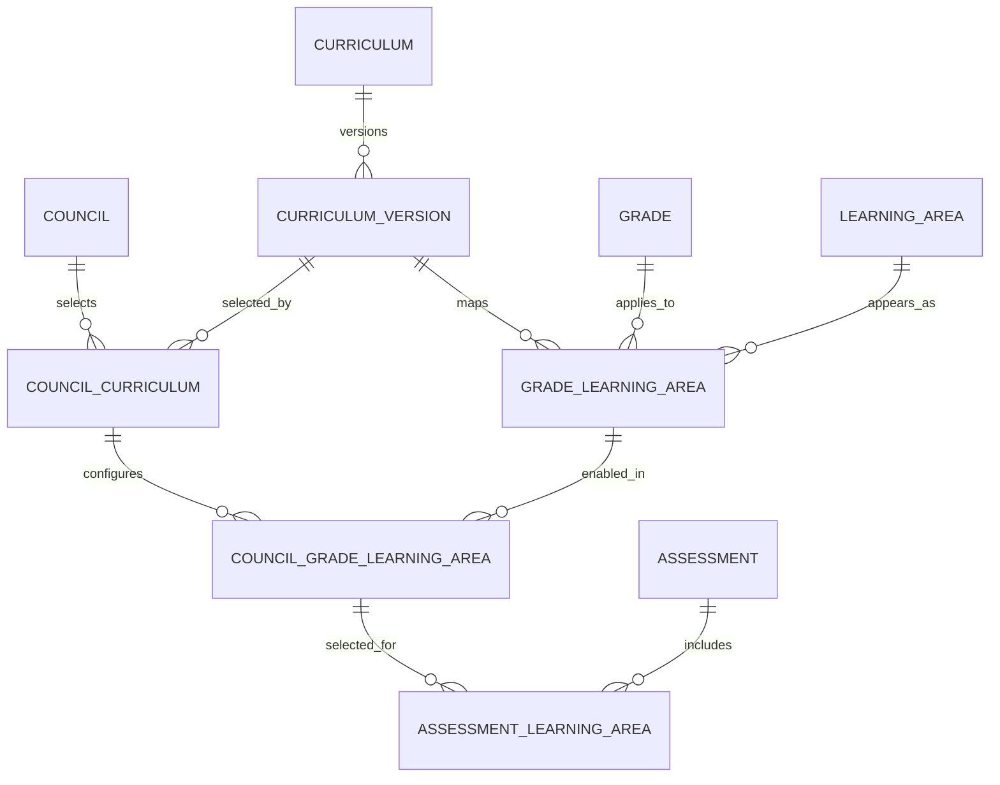
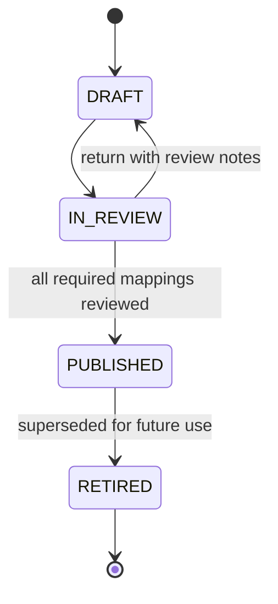

# Curriculum publication and Council configuration — technical design

**Status:** Proposed implementation design; no schema migration or production publication yet.  
**Related decisions:** ADR-018 (curriculum source/versioning), ADR-020 (staff assignment scope), ADR-022 (child-data release gate).  
**Source review:** `docs/research/kicd-curriculum-source-review.md`.  
**Initial review data:** `data/curriculum/kicd-regular-cbe-grades-1-9-review.csv`.

## 1. Summary

Separate the global, platform-managed curriculum catalogue from each Council's decision about which grade-level learning areas it offers and assesses. Import source material into an immutable draft, review grade mappings and optionality, publish a version, then let a Council select a published version and enable its own learning areas. An assessment snapshots the exact curriculum mapping and rubric version it uses.

The current KICD extraction is a review artifact only. It has 120 grade-to-learning-area rows; optionality and assessment eligibility remain `REVIEW_REQUIRED`. Do not seed these rows as published or assume all listed areas are compulsory or assessed by every Council.

## 2. Goals and non-goals

### Goals

- Preserve source names and exact grade applicability without embedding subject lists in TypeScript.
- Distinguish canonical LearningArea identity, curriculum-version mapping, Council enablement and assessment selection.
- Make curriculum changes auditable and immutable after publication.
- Allow multiple Council configurations against the same published national curriculum version.
- Ensure an assessment and its reports use the same curriculum/rubric snapshot throughout their lifecycle.
- Support source corrections and new KICD versions without rewriting historical assessments.

### Non-goals for the first slice

- SNE, pre-primary and Senior School (Grades 10–12) catalogue publication.
- Automatic inference of optionality, school language choices or Council exam blueprints.
- Universal CBE numeric grading boundaries.
- Learner enrollment, candidate, marks or result persistence with real data; ADR-022 remains a separate release gate.

## 3. Proposed data model

### Curriculum catalogue

- `Curriculum`: stable code, name and track (for example `KE_KICD_REGULAR_CBE`).
- `CurriculumVersion`: curriculum FK, version label, DRAFT/PUBLISHED/RETIRED status, source title/URL, retrieved/effective dates, source SHA-256, author/reviewer/publisher audit metadata.
- `LearningArea`: stable platform code and canonical label. Do not merge two different source labels solely because they appear similar. A reviewed alias table may be introduced later with provenance.
- `GradeLearningArea`: version FK, Grade 1–9, LearningArea FK, exact `sourceLabel`, source URL, sort order, optionality (`UNKNOWN`, `CORE`, `OPTIONAL`), review status and review note. Unique by `(curriculumVersion, grade, learningArea)`.

### Council configuration

- `CouncilCurriculum`: Council FK, published CurriculumVersion FK, effective dates and status. A Council has at most one active current version at a time; changing version creates a new effective-dated record rather than overwriting history.
- `CouncilGradeLearningArea`: CouncilCurriculum FK, GradeLearningArea FK, enabled flag, assessment-eligible flag, Council display label/order and review metadata. The selected GradeLearningArea must belong to the CouncilCurriculum's exact version.

### Assessment snapshot

- `Assessment` references the CouncilCurriculum selection/version used at creation.
- `AssessmentLearningArea` snapshots the selected CouncilGradeLearningArea ID, grade, source label/display label, maximum marks, decimal precision, ordering and any assessment-specific code. Snapshot rows become immutable once the assessment opens registration or mark entry.
- `Assessment` separately references a `GradingRubricVersion`; rubric bands and thresholds are Council-configured and versioned. No default PL1–PL8 or EE/ME/AE/BE numeric thresholds are inserted.

### Grade representation

Use one shared Grade 1–9 catalogue/enum across SchoolClass, curriculum mapping and assessment configuration. Do not encode grade bands as the grade itself. Grade-specific source names remain on GradeLearningArea.

## 4. State machine and publication rules

- DRAFT/IN_REVIEW versions are editable only by authorized Platform Curriculum Administrators.
- Publication requires complete source metadata, unique canonical codes, grade mappings, reviewed optionality/availability status, a reviewer distinct from the author, and a content hash.
- PUBLISHED and RETIRED versions are immutable. Fixes create a new version with a change summary and source evidence.
- A Council can select only a PUBLISHED version. A new Council selection has an effective date and does not alter prior assessments.
- An assessment snapshots selected learning areas and the grading rubric. Subsequent Council configuration changes apply only to future assessments.

## 5. API outline

| Method | Path | Role | Purpose |
|---|---|---|---|
| GET | `/api/platform/curricula` | Platform Administrator | List tracks and versions |
| POST | `/api/platform/curricula/import-preview` | Platform Administrator | Validate CSV and show mapping/source diffs without writes |
| POST | `/api/platform/curricula` | Platform Administrator | Create a DRAFT version from a validated preview |
| GET | `/api/platform/curricula/:versionId` | Platform Administrator | Review source, grade mappings, unresolved items and hash |
| POST | `/api/platform/curricula/:versionId/submit-review` | Platform Administrator | Move DRAFT to IN_REVIEW |
| POST | `/api/platform/curricula/:versionId/return` | Independent reviewer | Return with review notes |
| POST | `/api/platform/curricula/:versionId/publish` | Independent reviewer | Publish immutable version |
| GET | `/api/council/curriculum` | Council Administrator | Read current Council curriculum and grade-area choices |
| PUT | `/api/council/curriculum` | Council Administrator | Select an effective-dated published version |
| PUT | `/api/council/curriculum/grade-areas/:grade` | Council Administrator | Enable/disable grade learning areas and assessment eligibility |

The initial implementation may split preview/import into smaller operations, but it must preserve preview-before-write and distinct author/reviewer publication controls.

## 6. Import contract

Required CSV fields: curriculum code, version label, grade, learning-area code, exact source label, source URL, source title, source retrieval date, optionality status, review status, sort order.

Validation:

- reject unknown grade values, malformed URLs, duplicate `(version, grade, learning-area-code)` rows and duplicate source identifiers;
- require exact source label and provenance for every row;
- preserve unknown optionality as `UNKNOWN` / `REVIEW_REQUIRED`, never infer CORE;
- report added, changed, removed and duplicate mappings;
- compute and store SHA-256 of the uploaded source file;
- never merge LearningArea records by fuzzy name matching;
- create a DRAFT only after explicit confirmation of the preview.

## 7. Authorization and audit

- Platform Curriculum Administrator may import and edit drafts; only an independent authorized reviewer may publish.
- Council Administrator may select a published curriculum version and configure Council grade areas only for their own Council.
- Teacher assignment and assessment creation read the Council's current effective mapping from the server; clients cannot submit arbitrary LearningArea IDs.
- Each import, draft edit, review return, publication, Council version selection and grade-area change writes an audit event with actor, scope, source hash/version, before/after summary and reason.
- Published versions and assessment snapshots cannot be edited or deleted through ordinary APIs.

## 8. Migration and rollout

1. Finalize the canonical code list and grade mappings against the actual KICD grade-level design documents; resolve any source-page terminology changes and optionality with an authorized curriculum reviewer.
2. Add Curriculum, CurriculumVersion, LearningArea, GradeLearningArea, CouncilCurriculum and CouncilGradeLearningArea models and constraints.
3. Implement import preview and draft creation using the review CSV; do not publish it automatically.
4. Add reviewer workflow and immutable publication.
5. Add Council selection and per-grade learning-area enablement.
6. Add AssessmentLearningArea and GradingRubricVersion snapshots in a separate assessment migration.
7. Enable Subject Teacher assignments only when the target class grade has an enabled CouncilGradeLearningArea.
8. Run PostgreSQL integration tests for cross-Council isolation, version immutability, mapping uniqueness and snapshot integrity.

## 9. Privacy boundary

Curriculum reference data is not learner personal data. It may be implemented independently of learner onboarding. The later assessment slice must still obey ADR-022: curriculum availability does not authorize processing real learner identities, candidate registrations, marks or results.

## 10. Open review items

- Confirm exact source documents and effective dates for the initial regular curriculum release.
- Confirm whether Council curriculum selection is mandatory per school or per Council; current default is one active version per Council.
- Confirm Council-specific language choices and whether a Council may disable a nationally listed area.
- Confirm whether a Council can select optional areas for assessment and how school-level availability is represented.
- Confirm who is authorized to review/publish curriculum versions and how corrections are handled after publication.
- Confirm the Council rubric governance process and whether one Council can have multiple rubric versions for different assessment types.
